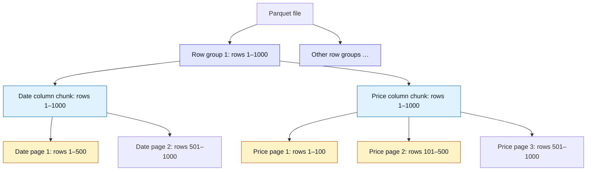
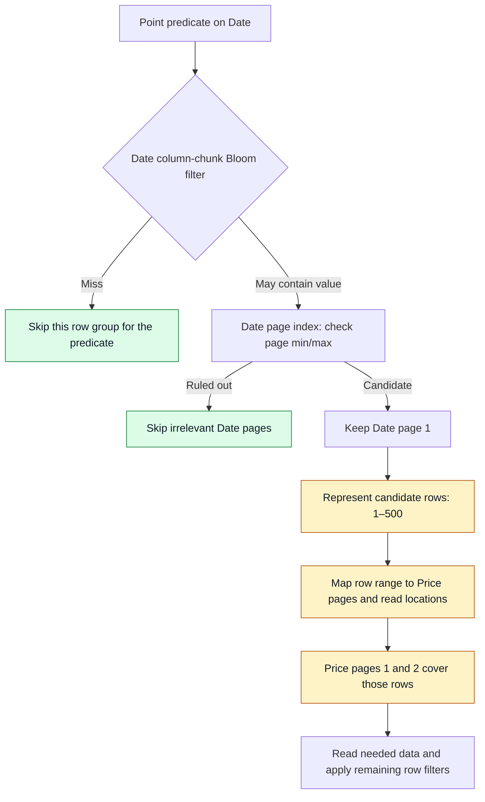

# 3 Granularity Wall

This section tests whether tuning [[Parquet]] to use smaller pruning units can reproduce the fine-grained execution that [[Mica]] targets. In the reported experiment, finer pruning reduces data reads but increases end-to-end latency: the [[Granularity Wall]].

## Parquet's File Layout and Pruning Units

[[Parquet Layout|Parquet's layout]] has three levels:

1. **Row group:** A contiguous range of rows shared by all columns.
2. **Column chunk:** One column's data within a row group.
3. **Data page:** A subdivision of a column chunk, with page boundaries determined independently for each column.

Files may also contain [[Bloom Filters]] and [[Page Indexes]] if the writer includes them. These support [[Predicate Pushdown|predicate pushdown]] at different granularities:

| Mechanism | Scope | What it can establish |
| --- | --- | --- |
| Bloom filter | One column chunk within one row group | A miss rules out that row group for the tested value; a hit means the value may be present but does not locate a matching page. |
| Page index | Individual pages within one column chunk | Page-level min/max statistics can rule out pages whose values cannot satisfy the predicate. |

For example, a `pickup_datetime` range filter can skip pages whose min/max timestamps lie entirely outside the requested interval. Smaller row groups can sharpen Bloom-filter membership pruning; smaller data pages can sharpen page-index pruning.

### Visual: File → Row Groups → Column Chunks → Pages

This illustrative layout expands one row group containing 1,000 rows and two columns. Both columns cover the same rows, but their page boundaries differ. Solid arrows mean "contains."

The amber pages show the mapping problem: **Date page 1 spans the same row range as Price pages 1 and 2 together.** Keeping "page 1" in both columns would miss price values for rows 101–500. These ranges illustrate the layout, not the paper's measured page sizes.

## Why Page Hits Need Row-Range Translation

Unlike Mica's [[Single Page Bitmap]], a Parquet page identifier is local to a column chunk, not shared across the file. The format does not require page boundaries to align across columns.

For illustration, Page 1 in a date column could cover rows 1–500 while Page 1 in a price column covers rows 1–100. Selecting a date page therefore does not identify the price pages to read directly.

The reader must express the selected region as row ranges, then map those ranges to pages and read locations in other columns. This [[Row-Range Translation]] adds planning work as the number of small units increases.

Parquet **can prune individual pages**. The limitation is that pruning one column's pages does not produce a shared page-ID selection usable by every other column. A candidate page also need not contain only matching rows; further filtering may be required.

### Visual: Pruning and Cross-Column Read Planning

For a point predicate on the Date column, the following simplified path assumes that Bloom filters and page indexes are present and used. Unlike the layout diagram, arrows here mean "next processing step."

Green nodes avoid reads; amber nodes show cross-column planning work. Candidate ranges may include nonmatching rows. A reader can refine them by evaluating the Date predicate before fetching Price data; the diagram shows the page-level candidate mapping. **More tiny units mean more metadata to inspect and more ranges to map**, explaining how finer pruning can encounter the granularity wall.

## Measurement Setup

* **Dataset:** NYC Taxi, described in the paper as 175 million rows and 4.64 GB across 12 monthly Parquet files.
* **Test file:** January, containing approximately 12 million rows, to isolate single-file read performance.
* **Query:** A highly selective point predicate for trips at `2021-01-15 12:34:56`.
* **Tuning:** Vary row-group (RG) and data-page (DP) row-count caps independently, holding the other parameter fixed for each transition.
* **Format caveat:** A data-page row-count cap does not establish aligned page boundaries across columns.

## Smaller Units: Fewer Reads, Higher Latency

* **Smaller data pages (Figure 4a):** Narrower page min/max intervals improve pruning. Rows selected for reading fall from roughly 40,000 to 20,000, but latency increases by more than 10×.
* **Smaller row groups (Figure 4b):** Finer membership pruning further reduces rows read, but latency increases from **156 ms to 657 ms**, approximately 4.2×.

These are separate tuning comparisons. The excerpt's latency breakdown provides the following sequence of configurations:

| Configuration | Row-group cap | Data-page cap | Rows selected for reading | Actual data reads | Pruning metadata loading and planning |
| --- | --- | --- | --- | --- | --- |
| Initial | 256k rows | 20k rows | 40,960 | 1.44 MiB | 5 ms |
| Smaller pages | 256k rows | 200 rows | 19,880 | 1.20 MiB | 150 ms |
| Smaller row groups | 1k rows | 200 rows | 5,120 | 0.14 MiB | 392 ms |

Across this sequence, data reads fall by approximately 10.3× while metadata loading and planning time rises by 78.4×. The selected-row counts describe pruning candidates, not a change in the query's final matching rows. The reported metadata timings include loading and planning; they are not measurements of CPU computation alone.

## Two Sources of the Granularity Wall

### Growing Metadata Without Efficient Sparse Loading

Smaller units create more pages, row groups, column chunks, and associated pruning metadata. The paper identifies a lack of format support for efficiently pruning this metadata before loading it: [[Sparse Metadata Loading]].

This is more precise than saying every Parquet reader always loads all metadata. In the tested execution, metadata loading and planning become increasingly expensive as the pruning units shrink. Mica's [[Layered Zone Maps]] address this by summarizing blocks of page metadata so irrelevant blocks can be skipped.

### Different Pruning Results Require Translation

Bloom filters operate at the column-chunk/row-group level; page indexes identify pages local to a column chunk. These results do not form one common physical unit shared across columns.

Consequently, finer pruning also creates more [[Row-Range Translation|row-range translation]] and I/O-planning work. Mica's aligned pages and [[Single Page Bitmap]] provide a common unit for carrying the selection across columns.

## Key Takeaway

In this experiment, tuning Parquet reduces bytes read without reducing latency. The result motivates designing the file layout, pruning metadata, and reader together so that managing fine-grained reads does not cost more than the reads it avoids. It does not establish that Parquet is slower for every workload or reader implementation.

Source: supplied Section 3 excerpt. Figures 3–5 are described in the text; the excerpt's final reference to further discussion is incomplete.

Previous: [[2 Background and Target Regime]] · Next: [[4 Mica - File Format Design|4 Mica: File Format Design]] · Index: [[Mica]]
