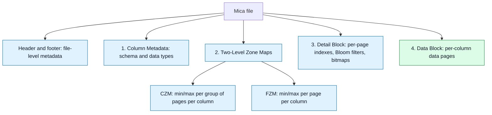
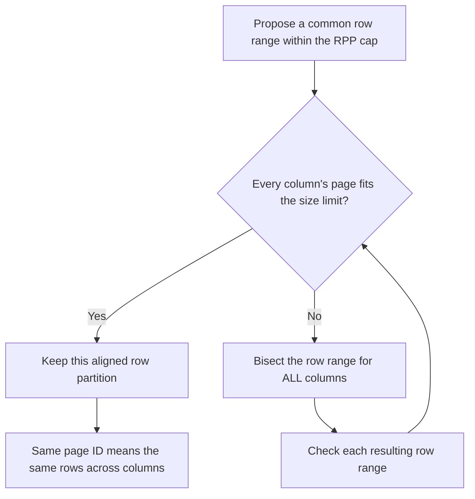

# 4 Mica: File Format Design

Mica organizes data and pruning metadata around a common page ID. The design addresses the two costs examined in [[3 Granularity Wall]]: loading too much pruning metadata and translating selections between columns whose page boundaries differ.

## Overview: File Layout

Alongside a conventional header and footer containing file-level metadata, such as the total row count, Mica has four main sections:

1. **Column Metadata:** File schema and column-level information, including data types.
2. **Two-Level Zone Maps:** [[Coarse Zone Maps]] and [[Fine Zone Maps]] provide min/max summaries at two granularities.
3. **Detail Block:** Additional metadata for each page in each column, including page indexes, [[Bloom Filters|Bloom filters]], and bitmaps.
4. **Data Block:** The actual per-column data pages.

### Visual: The Four Main Sections

This diagram shows logical containment, not byte offsets or relative section sizes. The two zone-map levels belong to one of the four main sections.

## Two-Level Zone Maps

* **[[Coarse Zone Maps|Coarse Zone Map (CZM)]]:** One min/max entry per group of consecutive pages, per column; §4.3 specifies a configurable group size with a default of 1,024 pages.
* **[[Fine Zone Maps|Fine Zone Map (FZM)]]:** One min/max entry per page, per column.
* The [[Layered Zone Maps|layered pruning approach]] loads the lightweight coarse map first, including on a cold read. If a group is ruled out, the reader skips its fine metadata. If it remains a candidate, the reader can load the relevant fine metadata to prune individual pages.
* A coarse-map candidate does not prove that any row matches; it means finer inspection is still needed.

The paper's Table 1 illustrates why loading these layers differently matters:

| ClickBench zone-map section | Approximate number of entries | Approximate size, as reported (MB) |
| --- | --- | --- |
| CZM | 51 thousand | 0.8 |
| FZM | 52.5 million | 800 |

In this example, the fine metadata is about 1,000 times larger than the coarse metadata. [[Sparse Metadata Loading]] avoids fetching irrelevant fine-map regions; the two levels do not make all metadata small.

## The Page as the Basic I/O Unit

* A page contains a contiguous row range for one column. Unlike the [[Parquet Layout]], Mica uses the page as its common I/O unit instead of separate row-group, column-chunk, and page pruning units.
* Page-level zone maps, indexes, Bloom filters, and bitmaps refer directly to pages. **CZM is the exception:** each entry summarizes a consecutive group of pages that can be translated into page IDs.
* File-level and column-level metadata still exist; the page association applies to the pruning structures described here.
* [[Rows Per Page|Rows per page (RPP)]] controls the target granularity, with a default cap of **200 rows**.
* RPP is an upper bound. The page-size limit and [[Recursive Page Bisection]] can produce fewer rows per page, as described in §4.1.
* A common page I/O unit does not require one system call per page: [[Bounded IO Coalescing|coalescing]] can combine reads, and [[Batched Asynchronous IO|batching]] can submit multiple requests together.

## Independent Addressability and Cross-Column Alignment

[[Independent Addressability]] lets the reader locate the required metadata or data block without first scanning preceding blocks. The excerpt describes metadata entries with known fixed lengths, allowing direct entry addressing once the relevant table's base location and layout are known.

Fixed-length metadata does **not** imply that every data page has the same encoded byte length or exactly 200 rows. Mica stores each data page's file offset and byte size in a per-column [[Page Indexes|page index]], supporting a [[Variable Physical Page Layout]].

The [[Cross-Column Row-Range Invariant]] means that a given page ID covers exactly the same row range in every column. Page 42 in the Date column and Page 42 in the Price column refer to the same rows, even though they contain different column values.

This alignment lets the reader carry page selections across columns through the [[Single Page Bitmap]], eliminating the per-column page-to-row-range remapping described in [[Row-Range Translation]]. It does not eliminate all metadata access, address calculation, or filtering within candidate pages.

## 4.1 Shared Page Domain Across Columns

The [[Cross-Column Row-Range Invariant|shared page domain]] gives a page ID the same logical row meaning in every column. Columns may use different encodings, compression, and encoded byte sizes for that page. Surviving page IDs from predicate columns can therefore be used directly to select reads for projected columns—the columns requested as output—without [[Row-Range Translation]]. Physical offsets still come from each column's page index.

### Write-Time Cost: Recursive Bisection

The writer must keep every column aligned to a common row partition. If any column's page exceeds the **default 16 MiB page-size limit**, it recursively bisects that logical row range **for all columns**, not just the oversized column.

For illustration, if a string column exceeds the limit for a proposed 200-row page, the writer splits the range into two 100-row ranges across every column, including narrow numeric columns. It repeats the split for ranges that remain too large. This is bisection of the range, not necessarily a split at the first row where a size threshold was crossed.

[[Recursive Page Bisection]] adds write-time coordination and can increase page-count overhead. It does **not** require narrow columns to pad their pages to the same byte size; §4.2 explains why Mica avoids that design.

## 4.2 Variable Physical Page Layout

*Editorial heading: the supplied excerpt omits the original §4.2 title. This heading describes the passage about padding and per-column page indexes.*

The shared page domain fixes logical row boundaries while leaving encoded byte sizes variable. The authors considered a uniform physical page size, which would make page offsets computable arithmetically, but rejected its padding cost.

* An Int8 column uses about one byte per row, while the example UTF-8 column averages roughly 30 bytes per row.
* With a uniform 8 KiB page and 200 Int8 values, about **97.6%** of the page would be padding. Reading the padded page also wastes I/O bandwidth.
* Increasing RPP pushes wide columns toward the size limit and bisection. Decreasing RPP spreads per-page overhead across fewer rows. Neither removes the mismatch between narrow and wide columns.
* Mica instead records **file offset and byte size for each page in each column**. This [[Variable Physical Page Layout]] preserves common row boundaries without imposing uniform byte lengths.

The tradeoff is a small page-index metadata cost in exchange for avoiding heavy padding. A shared page ID identifies which logical page to fetch; the column's index identifies where its bytes live.

## 4.3 Layered Pruning Metadata

[[Coarse Zone Maps|CZM]] and [[Fine Zone Maps|FZM]] let the reader pay for pruning precision in stages. For `N` pages per column and a coarse group size `G`, there are approximately `N / G` coarse entries and `N` fine entries per column. A final partial group still needs a coarse entry.

### Cold Reads and Sparse Fine-Metadata Loading

The passage reports roughly 50 million page entries across the ClickBench file and about **800 MiB** of FZM metadata. With the default `G = 1024`, CZM occupies only about **0.8 MiB**. The earlier table excerpt labels its sizes MB; these are the approximate MiB figures stated in §4.3.

1. Load the small CZM, including when the metadata is initially cold.
2. Reject groups whose min/max values cannot satisfy the predicate.
3. Read FZM entries only for surviving groups, then prune individual pages.

Loading the complete FZM would incur substantial I/O and memory overhead on a sparse query; it does not imply an inevitable system crash. Pre-warming FZM is optional for an upper layer such as an analytic engine. The design supports cold reads without requiring all fine metadata to remain cached.

### Coarse Granularity Is Independent of Data Granularity

`G` controls the **metadata layout**, while [[Rows Per Page|RPP]] controls the row cap for data pages. Reducing `G` increases the number of coarse summaries but does not change page boundaries, split data into additional segments, or change the bytes occupied by column data. This decouples coarse pruning precision from the physical data layout.

## 4.4 Per-Column Detail Blocks

The Detail Block section groups page-level metadata by column so the reader can load details for the predicate and projected columns it needs. It contains page indexes for physical addressing and membership structures chosen according to column cardinality—the number of distinct values.

| Column characteristic | Membership structure | Result |
| --- | --- | --- |
| High cardinality | One Bloom filter per page | Space-efficient approximate membership; hits may be false positives. |
| Low cardinality | A column-wide sorted dictionary and per-page presence bit vectors | Exact membership for values in each page, without Bloom-style false positives. |

The threshold is configurable at write time. These two membership structures are mutually exclusive per column, and column metadata tells the reader which one is present. See [[Page-Level Membership Pruning]] and [[Presence Bitmaps]].

### Combining Predicates in One Page Domain

For an AND predicate, a Bloom candidate set from column A can be intersected directly with a zone-map survivor set from column B using shared page IDs. No translation between column-specific page boundaries is required.

These remain **candidate pages**: even exact membership in two columns does not prove that both conditions hold on the same row. Row-level evaluation may still be necessary. A presence bitmap represents values within one page; the [[Single Page Bitmap]] represents surviving page IDs across the query.

## 4.5 Page-Local Decode Self-Containment

[[Page-Local Decode Self-Containment]] means a page can be decoded from its own bytes plus, at most, **one-time per-column state**. Dictionaries and symbol tables can be embedded in each page **or** stored once per column in the Detail Block.

After any needed shared column state is loaded, the reader can fetch an arbitrary subset of pages in any order and decode them independently and in parallel. It does not need neighboring data pages to reconstruct a selected page.

The cost is storage and encoding overhead:

* Pages repeat state such as encoding tags, raw sizes, and checksums even when neighboring pages use the same encoding.
* Smaller pages provide less data over which to amortize that state.
* Encodings such as [[Run-Length Encoding|run-length encoding (RLE)]] have fewer opportunities to exploit long repeated-value runs within each page.

Mica accepts these costs to keep sparse reads independent of neighboring pages. This overhead is distinct from the uniform-page padding rejected in §4.2.

### Run-Length Encoding: How Page Boundaries Affect Compression

[[Run-Length Encoding|RLE]] stores consecutive repeated values as a value plus a count. For example, `A A A B B` can be represented as `(A, 3), (B, 2)`. The counts preserve the original sequence when decoded; they do not simply count all occurrences of each value in the column.

Consider 1,000 consecutive copies of A:

| Encoding boundary | Illustrative run representation | Read consequence |
| --- | --- | --- |
| One 1,000-row page | One `(A, 1000)` run | One run description covers the larger page. |
| Five independent 200-row pages | One `(A, 200)` run in each page | Any selected page can be fetched and decoded independently. |

Splitting the run repeats its value/count description and per-page state. This can use more storage, but the reader can fetch just one small page when that is all it needs. Mica accepts that tradeoff for sparse access. The example illustrates the principle, not an exact on-disk encoding or compression ratio.

RLE works best when equal values occur consecutively. Merely having few distinct values is insufficient: alternating `A B A B` provides no long runs. The paper cites RLE as an example of the compression tradeoff, not as a mandatory encoding for every Mica page.

## How This Addresses the Granularity Wall

* **Shared page IDs:** Avoid repeatedly translating column-local page selections into other columns' page layouts.
* **Layered metadata:** Rule out groups before loading their fine-grained pruning metadata.
* **Independent addressability:** Locate needed entries and blocks directly.
* **Small pages:** Reduce irrelevant data reads when [[IO Selectivity|I/O selectivity]] is high.
* **Independent decoding:** Process selected pages without materializing neighboring data pages, after loading any shared column state.

Source: supplied Section 4 overview and §4.1–§4.5 excerpts. The pasted text has interleaved column fragments and omits the §4.2 heading; that subsection uses a descriptive editorial title.

Previous: [[3 Granularity Wall]] · Index: [[Mica]]
