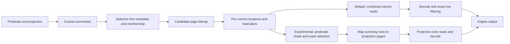

# Proposed Mica storyline

**Target:** SOSP/OSDI research paper. **Updated:** 2026-10-14. **Status:** research argument with completed predicate-first execution evidence and explicit remaining metadata/layout studies. Read [[experiments|experiments.md]] for executable study designs and [[prior-art|prior-art.md]] for positioning. Current implementation evidence is in [[evidence|evidence.md]].

**Recommendation.** Develop the paper around making fine-grained pruning economical through the joint design of metadata organization, shared row partitions and reader execution. The code implements aligned row partitions, directly addressable per-page metadata, fine membership pruning and separately batched physical execution. The evaluation must explain which of these choices preserve pruning savings and how the resulting tradeoff compares with strong alternatives across metadata residency states.

**Assessment today.** Mica has a credible systems contribution in making fine-grained pruning practical, supported by implemented mechanisms and recorded measurements. Its originality relative to the closest complete designs and the extent of its benefit still need stronger evidence. Established summaries and access methods do not disqualify a contribution from their organization and execution. The paper must identify what Mica changes, why that change matters and what it costs; it need not invent a new indexing algorithm or prove existing formats incapable of adopting the design. See the [[evidence#current-assessment|current evidence synthesis]].

1. **What the paper is about**

Working title: **Mica: Making fine-grained columnar pruning economical**.

The research question is: *How can a columnar system use fine-grained pruning metadata without metadata discovery, row mapping and physical execution consuming the data-work savings?* Metadata residency, locality and projection width determine the operating conditions to test; partial residency is one condition, not an assumed prerequisite.

The design lesson to establish is that useful pruning precision depends on how fine decisions are carried through metadata access and execution. Mica uses shared row identity and selectively addressable detail records to connect these stages, while physical reads can combine logical pages. Existing evidence supports this explanation, particularly selective metadata access. The importance of alignment and each execution policy remains to be isolated. The contribution can be this organization and the measured tradeoff it enables even though its individual indexing techniques are established.

The desired finding is more precise than “metadata is expensive.” Reducing the pruning unit changes both the amount of unnecessary data work and the amount of information a reader must locate, fetch, evaluate and translate before execution. Mica makes fine metadata entries directly accessible using shared page identity, while physical reads can combine those logical units. The intended result is that this organization makes useful pruning precision affordable over a measured range of metadata budgets, predicate distributions and projections.

The difficult part is showing why this exact organization matters relative to existing hierarchical indexes and modern columnar readers. Three evidence requirements distinguish a strong result from an implementation comparison:

- The gain persists against a competent existing format with comparable pruning information and metadata reuse. Otherwise extra indexing or caching explains it.
- Measured removal or substitution of a dependency changes the predicted cost. Otherwise the explanation is correlation.
- The effect changes full-query latency or useful throughput across a meaningful workload region, after storage and construction costs are counted. Otherwise the result is a favorable microbenchmark.

Source-level comparison must explain how Mica differs from the closest complete organizations and what those differences imply. Experiments must test whether they matter. No new constituent algorithm, superadditive interaction, universal lower bound or impossibility claim is required. If the design is portable to an existing format, its portability changes the deployment argument rather than automatically defeating the contribution.

2. **Suggested introduction, written without unearned results**

The following introduction combines implemented design, a completed bounded execution finding, and prospective metadata/layout claims. Preserve those distinctions. The predicate-first study does not turn the broader proposed comparisons into findings.

> Interactive analytical queries often restrict a large table to a time interval, an entity, or a combination of attributes. These restrictions can make reading and decoding an entire column wasteful. Existing columnar formats therefore support summaries, indexes and selective reads. The practical question is how much work a reader must perform to find and retrieve the relevant portion of a file.
>
> Fine-grained summaries can reject more irrelevant data, but they also create more metadata. A reader may read few data bytes while spending most of its time loading indexes, evaluating candidates and constructing physical read plans. Keeping detailed metadata in memory can avoid some of this work. That solution consumes a resource shared with query execution and cached data, and its value depends on how often the same files and predicates recur. We study this tradeoff for immutable analytical files on local NVMe, where small reads are practical but the work needed to discover them remains consequential.
>
> The design challenge is to preserve the savings from a fine pruning decision throughout the reader. Its metadata must be economical to locate and evaluate; its row interval must map to projected columns; and the required data and decode state must be retrievable without excessive requests or reconstruction. Hierarchical summaries address part of this problem. We study how metadata representation, row partitioning and physical execution together determine the useful pruning granularity.
>
> These costs do not automatically justify replacing a file format. Better readers may avoid repeated parsing, and auxiliary indexes may supply fine pruning without rewriting data. The design question is which costs can be removed while preserving stored data, and whether coordinating the metadata and data layout provides enough additional benefit to justify adoption. We distinguish these possibilities through reader-only, sidecar and layout comparisons.
>
> Mica addresses this challenge through a coordinated metadata layout and reader. A page identifier denotes the same row interval across columns. Fine zone maps, membership metadata and page locations refer to that identifier, and fixed-stride metadata arrays permit selected entries to be read without deserializing an entire fine index. Coarse summaries restrict subsequent refinement where possible. The reader then constructs physical plans from candidate pages, combines nearby reads, and exposes execution through adapters with explicit execution limits. Aggregate resource use remains an evaluation question. The writer preserves row alignment while allowing encoded byte lengths to vary across columns.
>
> Our controlled execution study demonstrates why pruning precision alone is insufficient. With equal surviving row counts, clustered survivors allow predicate-first execution to omit projection reads and reduce latency, while dispersed survivors eliminate the I/O savings. A real compound query saves requested bytes but issues more requests and becomes slower under advisory eviction. We therefore retain staging as an explicit experimental mode; the combined reader remains the default. These findings establish an execution tradeoff rather than a general staging speedup or a reason by themselves to replace a format.
>
> This organization has costs. Detailed metadata occupies disk space; smaller independent decode units can compress less effectively; coarse summaries and bitmap operations still depend on file size. Page-level evidence can also retain many rows that fail exact filtering. Our evaluation therefore compares complete query cost, metadata residency, stored bytes and construction cost. It tests whether Mica improves this tradeoff relative to tuned Parquet, indexed Lance, Vortex, ORC, and a compatible indexed-Parquet alternative, and identifies the cases where it does not.

For the final paragraph, report the actual S1–S3 results from [[experiments#e01|E01]]–[[experiments#e08|E08]], including the strongest comparator and loss region. Do not fill in invented percentages. Existing engine results may motivate the work internally, but a 2026-09-08 result against one uncompressed Parquet layout must not become a claim against every final baseline.

The introductory evidence should be a real query with a cost breakdown, not the old padded-read microbenchmark. Place the hardware study later unless [[experiments#e09|E09]] establishes a useful device-specific explanation. The Snowflake study can support the importance of filtering in one sentence. It cannot establish the prevalence of Mica's physical access pattern.

3. **Motivation and the figures that make the argument**

**Figure M1, [[experiments#e01|E01]].** Use a NYC time-plus-membership query and a ClickBench entity query, with fixed logical data order. Sweep actual page granularity in tuned native readers, Mica with eager fine metadata and full Mica. The two Mica lanes use identical files, pruning information and execution settings except metadata loading. Add an E02 matched-information comparison so stronger membership cannot silently explain a format difference. Plot latency, data bytes, metadata bytes and discovery CPU separately under cold and reused parsed metadata. Show each reader's best supported configuration. The target finding is where finer pruning saves data work, where discovery consumes those savings, and whether Mica shifts that tradeoff. Do not call it a universal wall if an ordinary reader improvement removes it.

**Figure M2, [[experiments#e03|E03]].** Plot end-to-end latency against an equal absolute metadata-memory budget under a many-file query sequence. Overlay total metadata working-set sizes and observed hit rates. Distinguish resident metadata bytes from reused parsed readers, and count the working set after table-level file pruning. The file set and query reuse must be motivated independently of observed speedup. This establishes whether memory residency makes the problem consequential. Reopening a file with all caches dropped for every request is a useful diagnostic endpoint, not the deployment itself.

**Figure M3, [[experiments#e04|E04]].** Start with the completed equal-retention clustered/dispersed pair from the [[evidence#predicate-first-results|execution results]], plotting actual requested bytes and latency separately. Label it a synthetic mechanism control, not workload prevalence. Add the real compound-query byte/request/latency mismatch as a second panel. The broader proposed sweep should show candidate-page retention and latency as row retention and physical clustering vary. Include an anticorrelated compound predicate and an unhelpful coarse summary. This defines the useful region before readers infer that a tiny output guarantees tiny work.

**Figure M4, [[experiments#e02a|E02a]]/[[experiments#e02b|E02b]].** Answer why the layout matters with a representative query across an optimized existing reader, equivalent sidecar, compatible rewritten layout where needed, and Mica. Show total latency alongside measured metadata/decode amplification and resident bytes. A small access-dependency diagram should explain each remaining cost. Do not present latency differences between these multi-factor implementations as additive causal contributions.

M1 motivates the granularity problem; M4 justifies the design response and belongs beside the design or early evaluation. M2 establishes the relevance of residency, and M3 establishes locality boundaries. Merge panels where useful rather than adding four mandatory standalone figures.

Useful terminology is `row retention fraction`, `candidate pages`, `metadata bytes fetched`, `data bytes fetched`, and `resident metadata bytes`. Avoid “high selectivity” meaning a low fraction in one paragraph and a high percentage in another. Count all predicate-column and codec-dependency reads, even if the final projection omits them.

4. **The precise contribution candidate and its limits**

| ID | Proposed claim | Required evidence | What would defeat it |
|---|---|---|---|
| S1 | Fine-grained filtering in the evaluated systems has a consequential discovery/execution tradeoff that depends on metadata residency and physical locality. | [[experiments#e01|E01]], [[experiments#e03|E03]], [[experiments#e04|E04]]; measured metadata, CPU and byte paths. | A competent standard configuration removes the tradeoff in the claimed regime, or the regime has negligible application impact. |
| S2 | Mica's particular metadata/page organization improves that tradeoff beyond adding equivalent index information or ordinary metadata caching alone. | [[experiments#e01|E01]], [[experiments#e02|E02]], [[experiments#e05|E05]], [[experiments#e07|E07]]; mechanism substitution, native alternatives and full resource accounting. | An equivalent existing layout or simpler established index explains the whole gain without a remaining distinct insight; a sidecar implementing a substantive new organization instead tests portability. |
| S3 | The benefit is useful inside analytical engines under the stated workload and resource limits. | [[experiments#e00|E00]], [[experiments#e06|E06]], [[experiments#e08|E08]]; exact semantics, full queries, loss cases and concurrency. | Reader improvements disappear in complete queries, depend on unfair budgets, or exact outputs differ. |

Current claim status: S1 has direct execution evidence from the completed locality/staging controls, while its broader granularity and reuse characterization remains open. S2a and S2b remain unresolved because the study uses the same Mica files and does not execute the compatible-layout comparison ladder. S3 has selected exact full-query evidence and explicit staging regressions; it must not be phrased as a general predicate-first speedup. See the [[experiments#evaluation-status|status matrix]].

S2 carries the principal design argument, with separate organization and integrated-layout obligations S2a/S2b in the [format rationale](#format-rationale). S1 explains the problem and its boundaries; S3 establishes practical consequence. Together they should show how Mica makes fine pruning economical and distinguish that result from the closest systems in [[prior-art|prior-art.md]]. Component ablations establish causality, not a requirement that every component be new or that their effects be superadditive.

Treat improvements as measured regions of a resource tradeoff, not universal multiplicative speedups. Selection of workloads and acceptable resource costs must precede final measurement. Statistical separation establishes a performance difference; it does not establish research novelty or practical importance.

5. **Design explanation in the order a reviewer needs it**

**Why introduce a format?** The missing argument is the link between the observed overhead and stored-layout choices. A slow small-page Parquet reader proves neither a format limitation nor a need to replace Parquet. Likewise, eager versus selective loading within Mica establishes a reader benefit on Mica files, not the benefit of changing file formats.

Separate two claims within S2. **S2a, the organization claim:** selectively addressable fine metadata and its execution path make fine pruning economical beyond simply adding pruning information or avoiding repeated reader construction. **S2b, the integrated-layout claim:** coordinating metadata, row partitions and data/decode units provides a consequential further benefit over the best compatible alternative, sufficient to justify its adoption costs. S2a is central. S2b is required for a headline about the advantage of Mica's new integrated format; it may fail while a portable metadata/reader contribution survives. Neither claim requires proving that all existing formats are incapable of expressing the design.

| Design choice | What it enables | Strongest alternative explanation | Evidence needed |
|---|---|---|---|
| Directly addressable detail records | Fetch selected metadata without reconstructing all detail records. | A better native parser/cache or a sidecar can provide the same access. | E02a P0/P1/P2 and E03, with identical files in P0/P1 and identical pruning information in the mechanism control. |
| Shared row partition | Carry candidate intervals across columns without boundary reconciliation at that logical level. | Efficient interval mapping or a compatible aligned writer makes reconciliation cheap. | E02a P2/P3 and E05; measure mapping CPU, allocations and data amplification, including alignment's write/compression cost. |
| Page-level decode with explicit locations | Retrieve the required data units and their codec state for candidate intervals. | Existing readers already support suitable access, or the observed gap comes from encoding quality. | E02b's identical-candidate retrieval control, including actual decode units and shared state; an uncompressed diagnostic plus native-codec results. |
| Separate physical batching | Combine small logical reads without giving up pruning precision. | This is reader functionality that can be added without changing a format. | Shared request-policy controls in E05/E09. Do not count batching alone as evidence for a new format. |

The final explanation should trace one query through the cheapest required metadata, mapping and decode dependencies in each alternative. Label each bottleneck as a reader implementation issue, a property of the particular file's stored representation, a writer/layout policy, or a verified format constraint. A particular file may require rewriting without requiring a new format specification. A library API limitation is not a format constraint.

The adoption argument is comparative. Show the extra performance or resource benefit of Mica over the strongest compatible alternative, then account for conversion, index construction, compression, retained copies and integration limits in E07. A self-contained file may simplify deployment, but that convenience is not measured evidence of a latency advantage. If a compatible layout matches Mica, credit the layout discipline or portable metadata organization and reduce the claim about a new format.

The current defensible wording is: "Mica introduces a format and reader designed together to make fine-grained pruning economical. We evaluate which benefits come from the reader, the metadata representation and the integrated data layout, and whether those benefits justify adopting the layout." Replace this evaluation promise with the supported comparative result after E02/E05/E07. A claim that a new format is necessary remains unsupported today.

With that rationale stated, explain the invariants and byte layout that implement the design.

**Shared row identity.** Page p covers the same row interval in every column. Each column has its own encoded page length and file offset. The writer bisects the whole row slice when a column exceeds the page budget. A matching page set can therefore be intersected across predicates without per-column boundary reconciliation. This removes one class of translation, not all planning. [[experiments#e05|E05]] measures whether that saving is consequential; [[experiments#e07|E07]] measures the cost of shared splitting and compression.

**Selective access to refinement information.** Coarse summaries select candidate groups; their relevant fine entries can be addressed directly. Per-page membership can refine equality or IN predicates. Offset metadata locates variable-length data pages. Some columns may need shared dictionary or codec state, which must be charged explicitly. Fixed-stride addressability is purchased with metadata space and restricted representations, not obtained for free. [[experiments#e01|E01]]/[[experiments#e02|E02]]/[[experiments#e03|E03]] quantify this choice.

**Separate the logical decision from the physical request.** Logical pages remain fine-grained, but the I/O layer can combine adjacent ranges and cap physical request sizes. Decode can amortize setup over eligible runs. The runtime has per-page plans and buffers as well as the bitmap; the bitmap is the common pruning representation, not the sole execution object. [[experiments#e05|E05]]/[[experiments#e09|E09]] test the contribution of batching and request policy.

**Exact execution in an engine.** The core prepares scan work and exposes tasks; adapters use engine budgets and restore projected outputs. Exact row filtering rejects false-positive candidate rows. The combined default reads candidate projection pages before exact filtering. An explicit experimental predicate-first path now defers surviving projection-page reads, with exactness and issued-I/O evidence in the bounded study report. Present it as a conditional reader tradeoff, not a new late-materialization idea or a general real-query speedup. Clustered controls benefit, while the dense full-query cases regress; no default promotion follows. Current dense-run eligibility is also narrower than “all projected fixed-width columns.” Refer to [[evidence|evidence.md]] for the implemented conditions. [[experiments#e00|E00]]/[[experiments#e06|E06]]/[[experiments#e08|E08]] validate semantics and integration.

A compact design diagram should distinguish the default combined read path from explicit predicate-first execution:

The row-page identity connects metadata and per-column locations. Byte ranges and output rows remain different objects. Draw shared codec dependencies as an extra input to decode in the final figure if the selected codecs require them.

A cost description should account for total row-pages P, coarse group size G, total schema columns C_total, predicate columns C_pred, planned columns C_plan, intermediate candidates A, final candidate pages K, physical requests R and decoded bytes D. The prepared-file open path loads coarse maps for all schema columns, giving order C_total P/G work and residency. The request-aware adaptive open path can limit that term to relevant predicate/equality columns. Identify the actual path in every experiment. A dense bitmap pass costs order P/64 and page plans order C_plan K. Detailed refinement depends on A, not only K. Run setup depends on R or contiguous runs, while decode still depends on pages and bytes. This is an explanatory accounting, not a latency theorem or an additive wall-clock model under overlapping execution.

6. **What to emphasize, reduce, and leave out**

Emphasize direct access to fine metadata at useful granularity, its interaction with row alignment and independent decode, and the measured latency/residency/storage tradeoff. Explain why a particular dependency costs time on real queries. Give sparse metadata loading substantial attention because existing ablations support it, while remaining honest about its precedents.

Reduce the contribution weight of manually chosen gates, 256 KiB caps, standard bitsets, io_uring, and individual decoder heuristics unless [[experiments#e05|E05]] shows a substantial independent role. Describe their policies accurately rather than asserting optimality. Preserve any negative ablations that expose limits.

Do not claim to introduce hierarchical summaries, metadata pruning, a universal page ID concept, late materialization or asynchronous NVMe access. Do not claim optimal physical I/O, constant work at fixed output cardinality, a globally optimal pruning policy, or cost proportional only to final survivors. Do not call wider scalar schemas support for nested types.

A distributed scheduler, transactions, arbitrary nested schemas and remote-object storage are outside this thesis. The current file-local immutable design is a legitimate scope if useful deployment evidence supports it. Scope is not a remedy if the only surviving workload is an artificial empty-result cold lookup.

7. **How the evaluation should read as an argument**

Lead with [[experiments#e06|E06]] full-query outcomes under explicitly stated resources, then explain the mechanism with [[experiments#e01|E01]] and [[experiments#e05|E05]]. Place the hardest alternatives from [[experiments#e02|E02]] and metadata-budget result [[experiments#e03|E03]] in the main paper. Show the boundary [[experiments#e04|E04]], storage/ingest tradeoff [[experiments#e07|E07]], and concurrent behavior [[experiments#e08|E08]]. [[experiments#e09|E09]] explains the hardware assumptions only to the extent its results matter. [[experiments#e00|E00]] supports every measurement; its failure blocks performance claims.

Use the completed predicate-first results as an execution boundary study, including the real-query losses alongside the clustered-control gains. Keep the September single-CPU staging cohort separate from the earlier 32-thread engine cohort. The selective Mica-versus-Parquet advantage in the new cohort already exists in combined mode. Do not attribute it to staging or select the fastest mode separately for each test query and present that as a deployed policy.

Within that order, distinguish discovery from known-survivor retrieval, matched-information comparisons from native product comparisons, and diagnostic cold states from deployment reuse. Never subtract separately timed medians to manufacture a causal stage cost. Show gains and losses per query; aggregate only with explicit workload weighting.

8. **Decision after the experiments**

**Proceed with the proposed paper** if the nearest competing mechanisms leave an explainable, important tradeoff unresolved, Mica changes it under fair resource accounting, and this matters for complete queries over a credible workload region. State exactly which dependency Mica removes and what cost it pays. Lead with the integrated-format advantage only if S2b passes E02b and E07; passing S2a alone supports the metadata/reader organization claim.

**Reframe toward a portable technique** if the Parquet sidecar reproduces the advantage but requires the same substantive new organization and that organization is not already provided by prior work. Demonstrating portability could strengthen a general systems contribution. The format name then becomes an implementation, not a necessity claim.

**Reconsider the current contribution** if the closest established design already provides the same organization and outcome at comparable cost across the intended workload, leaving no distinct design insight or consequential systems finding. Familiar constituent techniques, a matching single-query baseline, an additive combination of improvements, or portability alone do not establish this outcome. If the remaining difference is only unexplained implementation speed, more speedup plots will not resolve it. Extensions should address measured limits from [[experiments#e01|E01]]–[[experiments#e05|E05]], not manufacture novelty through added complexity. See [[design-extensions|design-extensions.md]].

The [[stress-test|stress-test record]] explains why broader candidate stories were rejected and what remains empirically unresolved. A completed narrative review does not imply that the paper's performance claims are validated.

---

## Vault Navigation & MoC Context

- [[Mica]]: Central Level 3 Project Hub for Mica paper notes and core concepts.
- [[README|Mica Plan Overview]]: Master roadmap and synthesis of the SOSP/OSDI research plan.
- [[prior-art|Mica Prior Art]]: Primary-source positioning and novelty analysis.
- [[experiments|Mica Experiments]]: Comprehensive experimental campaign E00–E09.
- [[evidence|Mica Evidence]]: Implementation status audit and empirical evidence synthesis.
- [[design-extensions|Mica Design Extensions]]: Infrastructure requirements and conditional architecture extensions.
- [[stress-test|Mica Stress Test]]: Stress-test ledger and falsification criteria.

